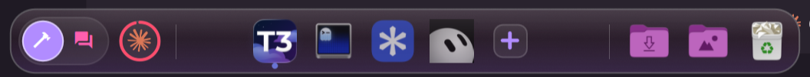
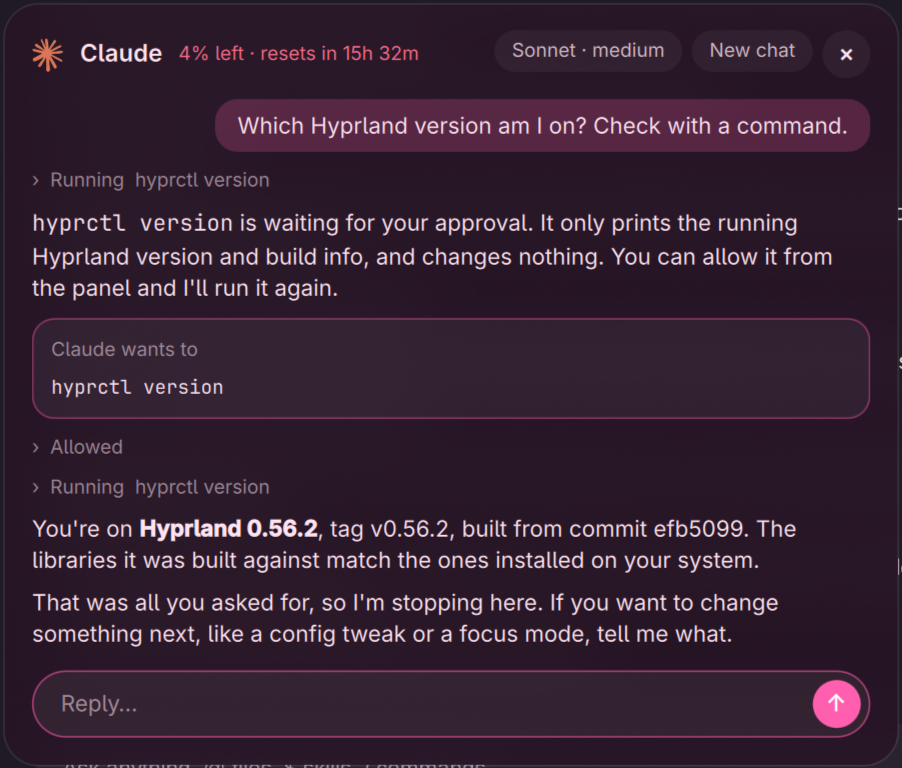
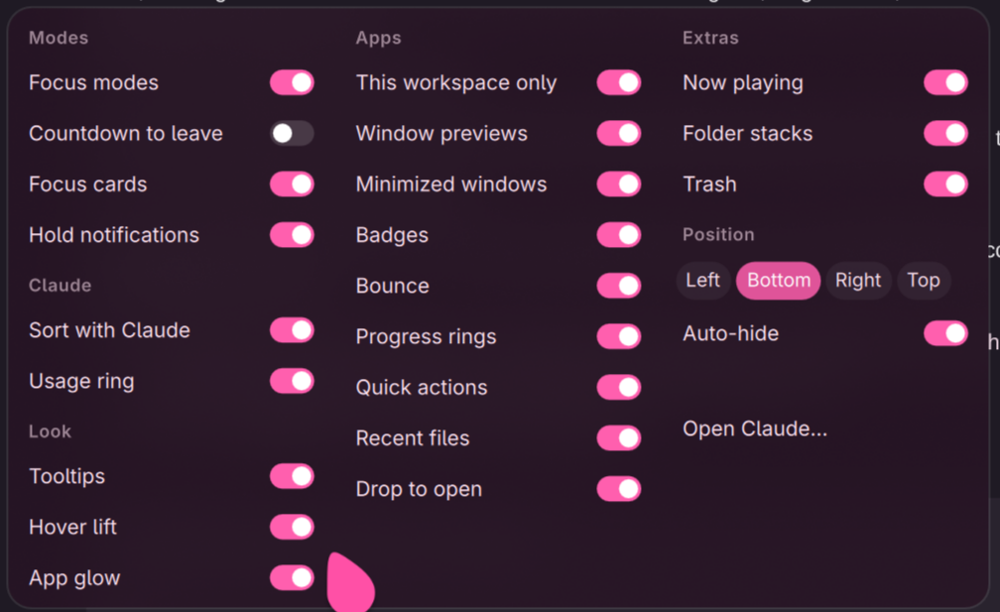

# Petal

**An AI-native, liquid-glass dock for [Omarchy](https://omarchy.org).**
Focus modes per workspace, a dock that knows what you're doing, and Claude Code built in.



## What it does

- **Focus modes.** Building, Writing, Social, or any modes you make. Each mode has its own apps,
  color and rules. Every workspace remembers its mode, so swiping between workspaces swaps the
  dock too. Click a mode to switch.
- **Focus cards.** When the window in front doesn't belong to the mode you're in, a small card
  asks: *stay focused, or switch?* Petal knows your apps; for anything new (a website, an app
  it hasn't seen) Claude Haiku decides which mode it belongs to.
- **Held notifications.** In a mode that holds notifications, messages from apps outside the
  mode are taken off screen (they stay in Omarchy's notification history) and wait on their
  mode with a count. Your mode's own apps come through normally, buttons and all. Claude flags
  held messages that can't wait.
- **Claude, in the dock.** The Claude button opens a real Claude Code chat. Ask it to add a mode,
  fix a config, find a file or explain why your laptop is slow. It reads, searches and edits
  files on its own and **asks you before running any command** ("Allow / Don't allow"),
  unless you give it full access. One model and effort setting, right in the panel.
- **Usage ring.** A ring around the Claude button shows how much of your Claude Code limit is
  used (pink, amber at 70%, red at 90%). Hover for numbers; the panel shows when it resets.
- **A good dock, too:** unread badges, a single bounce when an app needs you, download progress
  rings, quick actions and recent files on right-click, drop files on an app to open them (or on
  the trash), live window previews, minimized windows (Super+M) as thumbnails, now playing,
  folder stacks, app-colored glow, hover lift, auto-hide, every screen.

Every feature is a switch: right-click the "+" or the dock's glass.

<p>
  
  
</p>

## Requirements

- **Omarchy 4.5+** (Hyprland, and Omarchy's Quickshell-based shell, which hosts Petal as a plugin)
- `busctl` (systemd), `gio`, `python3`: all on a stock Omarchy install
- **Optional, for the AI features:** [Claude Code](https://docs.anthropic.com/en/docs/claude-code)
  (`claude` CLI), logged in. Petal uses your existing Claude Code login and plan, and its
  calls count toward your Claude usage. Without it, everything else works.
- A Nerd Font for the mode icons (Omarchy ships JetBrainsMono Nerd Font)

## Install

```bash
git clone https://github.com/edgetr/petal ~/Dev/Petal
cd ~/Dev/Petal
./install.sh
omarchy restart shell
```

`install.sh`:

1. links `plugin/` into `~/.config/omarchy/plugins/egesuren.petal`
2. links the `petal` command into `~/.local/bin`
3. creates `~/.config/petal/modes.json` from `defaults/modes.json` (if you don't have one)
4. finds your `claude` CLI and writes its path to `~/.config/petal/settings.json`
5. enables the plugin in `~/.config/omarchy/shell.json`

Then turn off Omarchy's own dock if it is on, so you don't have two.

Updating: `git pull && petal restart`.

## First steps

1. **Pick a mode** for each workspace: click Building, Writing or Social. Each workspace remembers it.
2. **Add apps** to a mode with the **+** button (type to search; folders become stacks).
   Right-click an app and use **In modes** to put it in several modes.
3. **Right-click a mode** to make it hold notifications, set it as default, or delete it.
   Turn on *Countdown to leave* in settings if you want a delay before leaving focus modes.
4. **Click the Claude button** and try *"Add a Gaming mode with Steam and Discord"*.

## Configuration

Everything lives in `~/.config/petal/` and reloads live when saved.

### `modes.json`

```jsonc
{
  "defaultMode": "building",            // for workspaces you haven't set
  "workspaces": { "1": "building" },    // workspace number -> mode (Petal fills this in)
  "modes": [
    {
      "id": "building",
      "name": "Building",
      "icon": "󰣪",                       // one Nerd Font glyph or emoji
      "color": "#b18cff",
      "about": "coding, terminals, GitHub", // what it's for; Claude sorts activity with this
      "apps": ["com.mitchellh.ghostty", "code"], // desktop ids, in dock order
      "sites": ["github", "localhost"],  // words in browser tab titles that belong here
      "focusDelay": 15,                 // countdown (s) before leaving, if countdowns are on
      "hold": true,                     // hold notifications from apps outside this mode
      "allow": ["slack"]                // apps whose notifications always come through
    }
  ]
}
```

Desktop ids are `.desktop` file names without the extension, from `/usr/share/applications` or
`~/.local/share/applications`. Apps that aren't installed are skipped.

### `settings.json`

Feature switches (the same as the settings menu) plus:

| key | default | |
|---|---|---|
| `chatModel` | `"sonnet"` | Claude panel model: `haiku`, `sonnet`, `opus`, `fable` |
| `chatEffort` | `"medium"` | `low`, `medium`, `high`, `xhigh`, `max` |
| `claudeAccess` | `"ask"` | `"ask"`: asks before commands; `"full"`: runs them without asking |
| `claudePath` | found by install.sh | path to the `claude` CLI |
| `stackFolders` | Downloads, Screenshots | folder stacks |

Position and auto-hide come from Omarchy's dock settings (`omarchy-dock position|autohide`).

## The `petal` command

```
petal mode <id>   switch this workspace to a mode
petal current     print this workspace's mode
petal modes       list modes and their apps
petal ask         open the Claude panel
petal search      open the add-apps search
petal settings    open the settings menu
petal edit        edit modes.json
petal restart     restart Omarchy's shell (reloads Petal)
```

## Privacy

Petal itself sends nothing anywhere. With **Sort with Claude** on, the app name and window
title of windows it doesn't recognize, and the app, title and text of notifications it holds,
are sent to Claude through your Claude Code CLI. The Claude panel works like any Claude Code
session in your home folder. Turn **Sort with Claude** off to keep window titles and
notifications local.

## Troubleshooting

- **Dock doesn't show:** `omarchy restart shell`, then check the log:
  `quickshell log "$(ls -td /run/user/$UID/quickshell/by-id/*/ | head -1)log.qslog" | grep -i petal`
- **Claude features do nothing:** check `claudePath` in `settings.json` and that `claude -p hi` works in a terminal.
- **Usage ring missing:** it uses Omarchy's `omarchy-agent-usage-claude`; run it to see if it works.
- **Two docks:** turn off Omarchy's built-in dock.

## Uninstall

```bash
./uninstall.sh && omarchy restart shell
```

## Credits

Built for Omarchy by [@edgetr](https://github.com/edgetr), with Claude. Inspired by an AI-native
focus dock idea from Thariq. The Claude logo is a trademark of Anthropic; Petal is not
affiliated with Anthropic or Omarchy.

MIT licensed.
